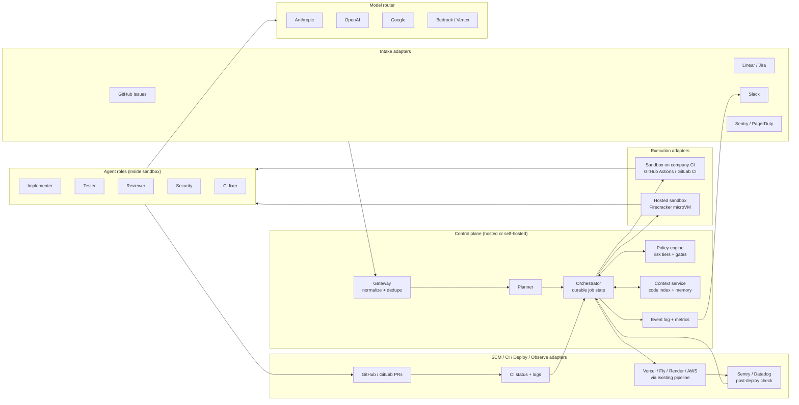

# Agentic Software Factory: Low-Friction Design for Small Companies

**Status:** design draft, 2026-11-02
**Audience:** a 5 to 50 person engineering org with no platform team

---

## 1. Problem statement

An agentic software factory takes work items in (tickets, bug reports, alerts) and
produces merged, deployed, verified software out, with LLM agents doing most of the
engineering labor and humans acting as reviewers and policy setters.

Existing products (Devin, Codex, Jules, Copilot coding agent, Factory.ai) each stop at
"opens a PR" and each assumes you adopt their surface. A small company has three
constraints the current market serves badly:

1. **No platform team.** Nobody is available to run Temporal, Kubernetes, or a vector
   database. If onboarding needs infrastructure, it does not happen.
2. **An existing toolchain that will not change.** GitHub, Slack, Linear or Jira,
   Vercel or Fly or AWS, Sentry. The factory has to meet these where they are.
3. **Low trust budget.** One bad merge and the tool is turned off. Autonomy has to be
   earned in visible steps, with a kill switch the founder can reach.

### Goals

- A company goes from zero to the first agent-authored PR in **under 30 minutes**, using
  only tools it already pays for.
- Every commonly used integration is a **pluggable adapter** behind one normalized
  schema, so adding Bitbucket or ClickUp is a new adapter, not a new system.
- **Zero infrastructure** option: sandboxes run inside the company's own CI minutes.
- Progressive autonomy with **policy-as-code** in one file the company owns.
- Agents never hold production credentials. Merge and deploy stay behind gates the
  agent cannot bypass.

### Non-goals

- Replacing the product decision of what to build.
- Replacing the company's CI or deploy pipeline. The factory drives them, it does not
  own them.
- Supporting every SCM on day one. GitHub first, GitLab second, others by adapter.

---

## 2. Design principles

| Principle | What it means in practice |
|---|---|
| Meet them where they are | Install is a GitHub App. Conversation happens in PR comments and Slack. No new dashboard required to get value. |
| One file of config | `factory.yaml` at the repo root holds intake sources, risk tiers, gates, budgets. A setup agent drafts it by reading the repo. |
| Defaults that are safe, not impressive | Shadow mode on install. Nothing merges until the company flips a tier. |
| Adapters, not integrations | Every external system speaks to the core through one of three adapter interfaces. The core never imports a vendor SDK. |
| Bring your own compute and keys | Sandboxes can run on the company's CI runners. Model calls can use the company's own provider keys so spend shows on their bill. |
| Reversible until a gate says otherwise | Agents work on branches. Humans or deterministic gates own merge. Deploy goes through the pipeline the company already trusts. |
| Everything is an event | Each agent action, tool call, and state change is appended to a log the company can export. Audit is a by-product, not a feature. |

---

## 3. Architecture overview



The control plane is small and stateless apart from Postgres and an object store. All
heavy compute (cloning, building, testing, running agents) happens in sandboxes that the
company can choose to host on its own CI.

---

## 4. The adapter model

Every external system is reached through one of three interfaces. The core depends only
on these interfaces. Adapters are separately versioned packages, so a company or a
third party can add one without touching the core.

### 4.1 Intake adapters

Turn an external signal into a normalized `WorkItem`.

```yaml
WorkItem:
  id: string               # factory-assigned
  source: { kind, external_id, url }
  repo: string             # owner/name, resolved by routing rules
  title: string
  body: string             # untrusted text, see section 8
  acceptance: [string]     # extracted or supplied
  labels: [string]
  reporter: { id, display }
  risk_hint: low | medium | high | null
  budget_hint: { tokens, minutes } | null
```

| Adapter | Trigger | Notes |
|---|---|---|
| GitHub Issues | label `factory`, or assignment to the bot | Zero extra setup once the App is installed |
| Linear | state change to "Ready for agent" or label | OAuth, webhook per team |
| Jira | JQL filter polled, or automation webhook | Covers Jira Cloud first |
| Slack | `/factory fix ...` or mention in a channel | Replies thread back to the same message |
| Sentry | new issue above a threshold | Creates a `bug` WorkItem with the stack trace attached |
| PagerDuty / Opsgenie | incident opened | High risk tier by default, human approval required |
| Email / forms | optional, via a webhook adapter | For agencies that take client requests by email |

### 4.2 Execution adapters

Provide an isolated environment with the repo checked out and a tool broker running.

```
interface SandboxProvider {
  create(spec: SandboxSpec): SandboxHandle      // repo, ref, image, limits, egress
  exec(handle, cmd, timeout): ExecResult        // all commands go through the broker
  snapshot(handle): ArtifactRef                  // for resume after crash
  destroy(handle): void
}
```

| Provider | Who pays for compute | When to use |
|---|---|---|
| GitHub Actions runner | the company's CI minutes | Default for small teams: zero infra, secrets already scoped by GitHub |
| GitLab CI runner | the company | Same model for GitLab shops |
| Hosted microVM (Firecracker) | the factory vendor | Long jobs, pre-warmed images, teams whose CI is slow or metered |
| Self-hosted Docker / Kubernetes | the company | Compliance or air-gapped environments |

The CI-runner provider is the key to "no friction." A job is a workflow run that the
factory dispatches via the SCM API. The agent runs inside the runner with a token scoped
to one branch. Logs, artifacts, and timeouts come free from the CI system.

### 4.3 Delivery adapters

Open and update PRs, read CI results, trigger and observe deploys.

| Adapter | Capabilities used |
|---|---|
| GitHub / GitLab / Bitbucket | branch, PR, review comment, check run, merge (only when policy allows) |
| GitHub Actions / CircleCI / Buildkite | read status and logs so the CI fixer agent can act |
| Vercel / Netlify / Render / Fly | preview URL for the PR, production deploy status |
| AWS / GCP via existing pipeline | the factory never calls cloud APIs directly; it merges and watches the pipeline |
| Sentry / Datadog / Grafana | error rate and latency on the deployed change for the post-deploy gate |
| Slack / Teams / Discord | notifications, approvals via buttons, thread per job |

### 4.4 Model providers

The model router presents one chat-with-tools interface over Anthropic, OpenAI, Google,
Bedrock, and Vertex. It handles:

- **Key ownership.** The company can bring its own keys so spend appears on its bill,
  or use the factory's metered keys.
- **Role-to-model mapping.** Implementer on the strongest model, reviewer on a different
  model family when configured, cheap model for classification and triage.
- **Prompt caching** of repo context and system prompts to keep cost per job bounded.
- **Failover** to a second provider on outage, with the event logged.

---

## 5. Onboarding flow: zero to first PR in 30 minutes

1. **Install the GitHub App** and pick repositories. Permissions requested: contents
   (read), pull requests (write), checks (write), issues (read), actions (write to
   dispatch workflows). No admin, no secrets access.
2. **Setup agent reads the repo** and drafts `factory.yaml`: detects language, test
   command, package manager, CI system, deploy target, and proposes risk tiers from the
   directory layout. It opens this as a PR so the first interaction is already a review.
3. **Connect intake.** One click for GitHub Issues. Optional OAuth for Linear or Jira,
   Slack app install for notifications. Each takes under five minutes.
4. **Shadow mode runs automatically** for seven days or ten jobs, whichever is first.
   Agents produce PRs marked `draft`, nothing merges, and a report compares them with
   human PRs on the same issues.
5. **Graduate** by editing `factory.yaml` to enable tier 1 auto-merge. The change is
   itself a PR, so the whole team sees the trust boundary move.

A company that only does steps 1 and 2 already gets agent-authored draft PRs on labeled
issues. Everything else is additive.

---

## 6. Core services

### Gateway

Receives webhooks and polls, verifies signatures, normalizes into `WorkItem`, dedupes
(same Sentry issue, same Linear ticket re-labeled), and applies routing rules from
`factory.yaml` to pick the repository. Stateless, horizontally scaled.

### Planner

For items above a small size, a planner agent decomposes work into a task graph with
dependencies and writes acceptance criteria when the source lacks them. For small items
it passes through. Output is reviewed by the policy engine before any sandbox starts.

### Orchestrator

A durable workflow engine (Temporal or an equivalent) owns the job state machine:

```
queued -> planned -> implementing -> verifying -> reviewing -> awaiting_approval
       -> merging -> deploying -> observing -> done | failed | paused
```

Durability matters because jobs run for hours and the runner executing an agent will
die. Every transition is an event. Budgets (tokens, wall-clock, CI minutes) are
enforced here, and exceeding one pauses the job and notifies rather than letting an
agent loop.

### Policy engine

Evaluates `factory.yaml` risk tiers and gates for each task. Decides which agents run,
which gates are mandatory, whether a human must approve, and whether the agent may
merge. Policy is versioned with the repo, so a change in trust level is a reviewable
diff.

### Agent roles

Specialized agents with distinct prompts and permissions, run in sequence or parallel
inside the sandbox:

| Role | Sees | Cannot |
|---|---|---|
| Implementer | task, repo, context index | merge, change CI config, edit tests it did not write unless allowed |
| Tester | task and diff only, not the implementer's reasoning | weaken or delete existing tests |
| Reviewer | diff and acceptance criteria, cold | push commits |
| Security | diff, dependency changes, static analysis output | approve |
| CI fixer | failing check logs and diff | touch files outside the failure's blast radius |

Separation of implementer and tester is the single biggest quality lever. The same
model grading its own work is the most common way these systems fail quietly.

### Context service

Per-repository code index (symbol graph from the AST plus embeddings for retrieval),
a knowledge store for architecture docs and conventions, and a write-gated memory of
lessons from previous jobs (flaky tests, build quirks). Memory writes require the job to
have completed successfully, which limits poisoning by a confused agent.

### Observability

Each job emits a trace with every agent turn, tool call, token count, and cost. Metrics
feed the Slack digest and an optional dashboard:

| Metric | Why it matters |
|---|---|
| Merge rate without human edits | True autonomy level |
| Defect escape rate per tier | Whether gates are calibrated |
| Cost per merged PR | Economic viability |
| Time to merge by tier | Throughput bottlenecks |
| Human review minutes per PR | Whether effort is saved or just moved |

---

## 7. Risk tiers and default gates

Tiers are assigned by path rules first, then by a classifier, and a human can override
on the PR with a label.

| Tier | Examples | Deterministic gates | LLM gates | Human | Merge |
|---|---|---|---|---|---|
| 0 | docs, comments, formatting | lint, build | none | none | agent |
| 1 | tests, dependency patch bumps, copy | lint, build, tests, secret scan | reviewer | none after shadow period | agent |
| 2 | feature code, bug fixes | all of tier 1 plus coverage delta, dependency policy | reviewer, security | one approval | agent after approval |
| 3 | auth, payments, schema migrations, infra, CI config | all of tier 2 plus migration dry run | reviewer, security | named owner approval | human only |

Deterministic gates always run before LLM gates. They are cheap and non-negotiable.

---

## 8. Security model

- **Credential scoping.** The sandbox receives a token for one branch of one repo,
  valid for the job's duration. Production secrets never enter the sandbox. Deploy
  happens by merging into a branch the company's existing pipeline already watches.
- **Egress allowlist.** Sandboxes reach the SCM, package registries, and the model
  router. Everything else is blocked by default and configurable per repo.
- **Prompt injection containment.** Ticket text, issue comments, and repository
  contents are untrusted. The tool broker enforces the role permission table regardless
  of what the model asks for, so an injected instruction can waste tokens but cannot
  escalate.
- **Tool broker.** Every command passes through a broker that logs it, applies
  allow/deny rules, and redacts secrets from output before it returns to the model.
- **Audit export.** The event log can be streamed to the company's SIEM or exported as
  JSON lines. Small companies rarely need this on day one, but it is what lets the
  product grow with them.
- **Kill switch.** A Slack command or a single label on the repo pauses all jobs. The
  founder should be able to do this from a phone.

---

## 9. Data model

```
Tenant        organization, billing, provider keys (encrypted), adapters installed
Repo          tenant, SCM ref, factory.yaml snapshot per job, index version
WorkItem      normalized intake, see 4.1
Job           work_item, repo, state, tier, budget, created_by, policy_version
Task          job, role, depends_on[], sandbox_id, status
Run           task, model, tokens_in/out, cost, duration, trace_ref
Artifact      run, kind (diff, test_report, review, log), object_store_ref
Event         append-only: job, task, type, actor, payload, ts
Approval      job, approver, decision, reason, ts
```

Postgres for everything except artifacts and traces, which go to object storage.
Multi-tenant by `tenant_id` on every row with row-level security.

---

## 10. Deployment modes

| Mode | Control plane | Sandboxes | Fits |
|---|---|---|---|
| Hosted, bring your CI | vendor, multi-tenant | company's GitHub Actions or GitLab runners | Default for small companies. No infra, spend visible in their CI bill |
| Hosted, hosted sandboxes | vendor | vendor microVMs | Teams with slow or metered CI, or long-running jobs |
| Self-hosted | Helm chart or Docker Compose in the company's cloud | company's runners or Kubernetes | Compliance, regulated data, or air-gapped |

The control plane in hosted mode runs on Kubernetes across two availability zones:
gateway, orchestrator workers, policy engine, context service, and a Postgres primary
with a replica. Sandboxes always live in a separate network boundary from the control
plane, so a sandbox escape does not reach tenant data. Infrastructure is defined as code
and the factory deploys itself through its own pipeline once stable.

Self-hosted mode ships as the same containers with a Compose file for a single VM and a
Helm chart for Kubernetes. Adapter credentials are read from the company's secret store
rather than the factory's.

---

## 11. Cost model and budgets

Each job carries a budget from `factory.yaml` defaults, overridable per tier. Typical
starting points a small company would set:

| Tier | Token budget | Wall clock | CI minutes |
|---|---|---|---|
| 0 | 200k | 10 min | 5 |
| 1 | 1M | 30 min | 15 |
| 2 | 4M | 2 h | 45 |
| 3 | 8M | 4 h | 90 |

Exceeding any budget pauses the job and posts to Slack with a resume button. Prompt
caching of repository context and system prompts, plus the cheap-model tier for triage
and classification, are the two levers that keep cost per merged PR predictable.

---

## 12. Failure modes and mitigations

| Failure | Mitigation |
|---|---|
| Agent weakens or deletes tests to pass | Tester runs separately, coverage delta gate, implementer forbidden from editing existing tests at tier 1 and above |
| Prompt injection in ticket or repo | Tool broker permission table independent of model output, egress allowlist, no secrets in sandbox |
| Runaway loop | Budgets enforced by orchestrator, not by the agent |
| Flaky CI blamed on the change | CI fixer reads memory of known flaky tests, retries once, escalates to human instead of "fixing" the test |
| Human rubber-stamping | Keep tier 3 small, sample tier 1 merges for weekly audit, surface review minutes in the digest |
| Model provider outage | Router failover, job pauses rather than fails, event logged |
| Memory poisoning | Memory writes gated on successful job completion, reviewable in a PR for the repo's knowledge folder |
| Worker crash mid-job | Durable workflow resumes from last snapshot of the sandbox |

---

## 13. Rollout plan for an adopting company

1. **Week 1, shadow.** Install, review the generated config, let agents draft PRs on
   labeled issues. Compare with human PRs.
2. **Weeks 2 to 4, tier 0 and 1 autonomy.** Docs, tests, dependency bumps merge on
   green. Watch defect escapes and review minutes.
3. **Month 2, tier 2 with approval.** Feature work lands behind one approval. Connect
   Sentry so the post-deploy gate has signal.
4. **Month 3, alert intake.** Sentry and PagerDuty open fix jobs automatically at tier
   2 or 3.

Each step has an exit criterion from the metrics table, not a date.

---

## 14. Trade-offs considered

- **CI-runner sandboxes vs hosted microVMs.** Runners are free of infrastructure and
  reuse the company's secret scoping, but cold starts are slow and some CI plans meter
  minutes. The default is runners with an opt-in to hosted for the top repositories.
- **One agent vs specialized roles.** Specialization costs more tokens and more
  orchestration. It catches far more defects and maps onto how teams already review
  work, so it stays.
- **Config file vs dashboard.** A file is less discoverable but is versioned, reviewed,
  and diffable. Trust changes become visible PRs. A dashboard can be added later as a
  view over the file.
- **Adapter per vendor vs generic webhooks.** Generic webhooks would be faster to ship
  but push mapping work onto the company. First-class adapters for the top ten tools
  are what remove friction; generic webhooks remain as the long tail.
- **Direct cloud deploy vs merge-and-watch.** Calling Vercel or AWS directly would be
  faster but puts production credentials in the factory. Merge-and-watch keeps deploy
  inside the pipeline the company already trusts.

---

## 15. Open questions

- How much of the setup agent's generated `factory.yaml` should be opinionated about
  tiers for monorepos with mixed ownership?
- Should the reviewer always run on a different model family from the implementer, or
  only at tier 2 and above where the token cost is justified?
- What is the minimum viable self-hosted footprint: can the control plane run as a
  single container with SQLite for a 5-person team?

---

## 16. Implementation status (2026-11-03)

A working implementation lives in [this repository](../README.md)
as the `asf` Python package. Its README maps each component above to code and states
what is live-tested, unit-tested only, or not built.

Deviations from this design, chosen to keep the zero-infrastructure path real:

- **SQLite instead of Temporal and Postgres.** The orchestrator is a resumable state machine
  that writes state after every step. The store interface is small enough to swap.
- **Triage instead of a task-graph planner.** Epics and items that need missing information
  or decisions are parked for a human with a reason, rather than decomposed.
- **Context from instruction files and a repository map.** There is no embedding index or
  per-repo memory yet.
- **One model provider.** The interface is provider-neutral, and Anthropic is the only adapter.
  Server-side refusal fallbacks stand in for cross-provider failover.

Lessons that changed the design during the build:

- **Gates must compare against the base commit.** Real repositories often have failing tests
  or type errors on main. Without the comparison the factory blames every change for them.
- **"Needs a device check" is not "not automatable".** Triage now separates the code change
  from manual verification. Items that need manual checks are still built, but can never be
  agent-merged, and the PR carries the checklist.
- **Retries start from a clean sandbox.** Leftover edits from a failed attempt confuse the
  implementer's account of what it changed.
