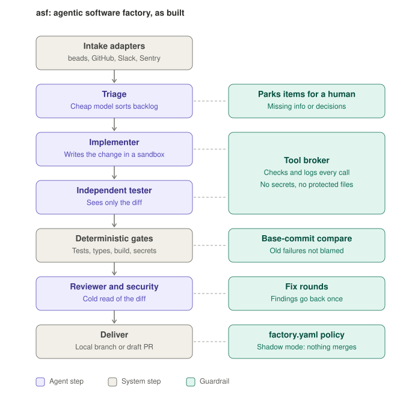
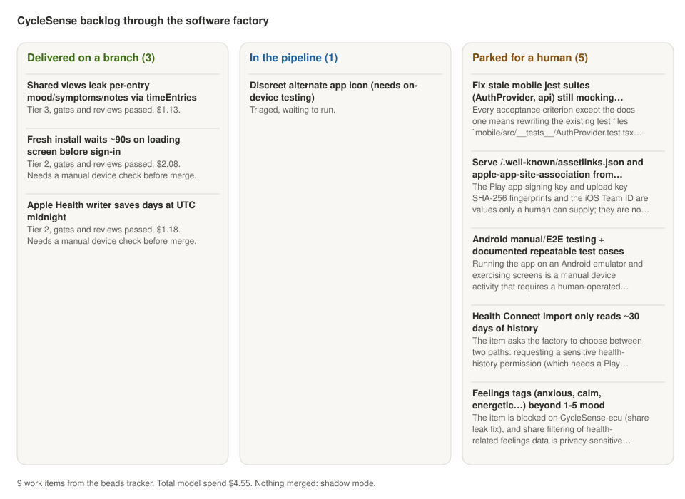

# How the software factory was built, with CycleSense as the first customer

This is a worked example. It records how `asf` went from an interview question to a
working factory, what broke along the way, and what happened when it was pointed at a real
product backlog. The design is in [DESIGN.md](../design/DESIGN.md)
and the code map is in the [README](../README.md).



## 1. From question to design

The work started as a system-design question: how would you design and deploy an agentic
software factory? The first answer set out six layers: intake, durable orchestration,
sandboxes, specialized agent roles, deterministic gates, and observability. Its central
claim was that the hard part is not the coding agent but the harness around it.

A second question asked whether such a factory already exists. Devin, Codex, Jules, the
Copilot coding agent and Factory.ai all stop at "opens a pull request" and leave the
governance to the customer. That gap shaped the design brief: a factory that a 5 to 50
person company can adopt with the tools it already has and no platform team.

Four decisions came out of that brief and survived the build:

- **Adapters, not integrations.** Every outside system is reached through one of a few
  small interfaces, so a new tracker or code host is a new adapter, not a change to the core.
- **One file of policy.** `factory.yaml` holds the trust boundary: risk tiers, gates, budgets,
  merge rights. Agents cannot edit it, so raising autonomy is always a human-reviewed diff.
- **Shadow mode by default.** Nothing merges until the team says so.
- **Zero infrastructure first.** Sandboxes are git worktrees on a laptop or CI runner. Docker
  and hosted sandboxes are optional.

## 2. Build order

The factory was built from the inside out, so each layer could be tested before the next
one depended on it.

| Step | What was built | Why in this order |
|---|---|---|
| 1 | Work item and job models, config loader with safe defaults, policy engine, SQLite event store | Everything else reads policy and writes events |
| 2 | Adapter interfaces and registry, git-worktree sandbox | The core may only talk to interfaces |
| 3 | Tool broker | The only path from a model to the sandbox; it had to exist before any agent |
| 4 | Model providers: Anthropic, plus a scripted provider that replays fixed tool calls | The scripted provider makes the whole pipeline testable for free |
| 5 | Agent roles and prompts, deterministic gates, resumable orchestrator | The pipeline itself |
| 6 | Intake, delivery, notify and observe adapters; setup agent; CLI; webhook gateway; CI workflow generator | Everything a company touches |
| 7 | 34 end-to-end and unit tests | Happy path, merge after approval, fix rounds, budget pause, kill switch, prompt injection, crash recovery |

## 3. Reusability checks, and what they caught

The rule for the build was to step back whenever something only worked for one
repository. Before CycleSense, the factory ran on a fresh Python project it had never
seen. Then it ran on CycleSense, a TypeScript monorepo with a web app, a server and an
Expo mobile app. Five problems surfaced. Each fix is generic and has a test.

| Problem found | Where | Generic fix |
|---|---|---|
| The sandbox crashed when a dependency folder was already gitignored | Python test repo, first real run | Exclude only dependency folders git does not already ignore |
| A retried job's implementer found the failed attempt's edits and wrote a confused summary | Python test repo | Retrying resets the sandbox to the base commit |
| Triage refused every item that needed a device check, even when the code fix was simple | CycleSense backlog | Split "can the code be written" from "what must a human verify". Such items are built, never agent-merged, and the PR carries a checklist |
| Main already had 16 failing server tests and 8 type errors, so every change would be blamed | CycleSense gates | Gates rerun failing commands on the base commit and report old failures as pre-existing |
| Cloning about 120,000 dependency files took three minutes per sandbox | CycleSense sandboxes | One copy-on-write clone per lockfile version, shared by all sandboxes through a symlink |

The setup agent also had to learn CycleSense's shape. Its root test script runs two
Vitest configs in sequence, and the mobile app has its own Jest setup. The detector now
splits composite test scripts into one package per area, reads `tsconfig.json` include
globs to decide which changes trigger the typecheck, and gives the mobile folder its own
package. Gates then run only the checks that cover the changed files.

## 4. Using it on CycleSense

```bash
asf --repo ~/work/CycleSense init                 # draft factory.yaml, commit it on branch factory/setup
asf --repo ~/work/CycleSense doctor               # all commands, adapters and the API key check out
asf --repo ~/work/CycleSense intake --source beads
asf --repo ~/work/CycleSense run --all --stop-at triaged     # triage the whole backlog cheaply
asf --repo ~/work/CycleSense run --job JOB-3efd94             # run one item end to end
```

The developer's checkout was never touched. Its uncommitted beads file stayed exactly as it
was. Each job ran in its own worktree under `~/.asf/CycleSense-98c570/sandboxes/`, and each
delivered job left a local branch in the CycleSense repository plus a report in
`~/.asf/CycleSense-98c570/reports/`. Nothing was pushed.



| Outcome | Items | Model spend |
|---|---|---|
| Delivered on a local branch, gates and both reviews passed | 3 | $4.39 |
| Stopped by policy, waiting for a human decision | 1 | $0.16 |
| Parked at triage with a specific reason | 4 | under $0.01 |
| Triaged, not yet run | 1 | under $0.01 |
| **Total** | **9** | **$4.55** |

Highlights:

- **The P1 privacy leak** is the bug where shared views exposed mood, symptoms and notes
  through `timeEntries`. The fix is a filter that fails closed: unparseable data returns
  nothing rather than the raw string. The implementer and tester added 14 tests between them.
  Both reviewers approved. The security reviewer suggested switching from removing known
  fields to allowing only known fields, which is a sound follow-up. The fix touches health
  data, so it is tier 3 and only a human can merge it.
- **The Apple Health date bug** was fixed with local-date handling and a timezone test file.
  Its report carries an on-device check that a human must do before merging. Cost $1.18.
- **The 90-second loading screen** got a new `ClerkLoadGate` component that times out with a
  retry message instead of spinning forever, plus two test files. It took the implementer 51
  turns, the most of any job, and cost $2.08 in total. It also needs an Android device check
  before merge.
- **The stale Jest suites** item was a deliberate test of policy. Fixing it means rewriting
  two existing test files, which agents may not do above tier 0. The implementer stopped
  after six turns and $0.16 and named the two files a human would have to allow. Adding a
  `tier:0` label to the ticket is the explicit way to let the factory do it.
- **Four items were parked with specific reasons.** One lacks signing-key fingerprints only a
  human has. One needs a product decision about a sensitive permission. One needs a person
  driving an emulator. One is blocked until the privacy fix lands, which triage noticed on
  its own.

## 5. How cost is measured

Every agent is a direct call to the Claude API through the Anthropic Python SDK. It uses the
API key in `work/jobsearch/.env`, not a Claude subscription. After each model call the
factory reads the token counts the API returns in `response.usage`. It multiplies them by the
list prices in `asf/adapters/models/anthropic_provider.py` and writes one row per call to the
`runs` table. A job's cost is the sum of its rows. The budget checks read the same numbers,
before every call, and pause a job that goes over its cap.

Breakdown for the privacy fix:

| Role | Model | Calls | Uncached input | Cache reads | Cache writes | Output | Cost |
|---|---|---|---|---|---|---|---|
| Triage | claude-haiku-5-5 | 1 | 4 | 0 | 1,711 | 372 | $0.00 |
| Implementer | claude-opus-5-5 | 15 | 32 | 393,388 | 51,458 | 7,788 | $0.49 |
| Tester | claude-opus-5-5 | 10 | 22 | 162,829 | 30,776 | 4,891 | $0.28 |
| Reviewer | claude-opus-5-5 | 9 | 20 | 138,899 | 22,107 | 2,573 | $0.19 |
| Security | claude-opus-5-5 | 6 | 14 | 76,700 | 22,857 | 1,667 | $0.16 |
| **Total** | | **41** | | | | | **$1.13** |

Prices used, in dollars per million tokens:

| Model | Input | Output | Cache read | Cache write |
|---|---|---|---|---|
| claude-opus-5-5 | 4.00 | 20.00 | 0.20 | 5.00 |
| claude-haiku-5-5 | 0.10 | 0.50 | 0.01 | 0.125 |

Prompt caching does most of the work. Almost all input tokens are cache reads at a twentieth
of the input price, because each agent's system prompt and growing conversation are cached
between turns. Output tokens include the model's thinking.

This is an estimate from list prices, not the invoice. The Anthropic Console bill is the
source of truth. The estimate also assumes the five-minute cache, and it would price a
refusal fallback at the requested model's rate. No fallbacks happened in these runs.

## 6. Try it on another repository

```bash
pip install -e .
asf --repo <path> init && asf --repo <path> --env-file <file with ANTHROPIC_API_KEY> doctor
asf --repo <path> add --title "..." --accept "..."      # or enable an intake adapter
asf --repo <path> run --all
python docs/render_backlog_svg.py ~/.asf/<repo-dir>/factory.db board.svg "<name>"
```
